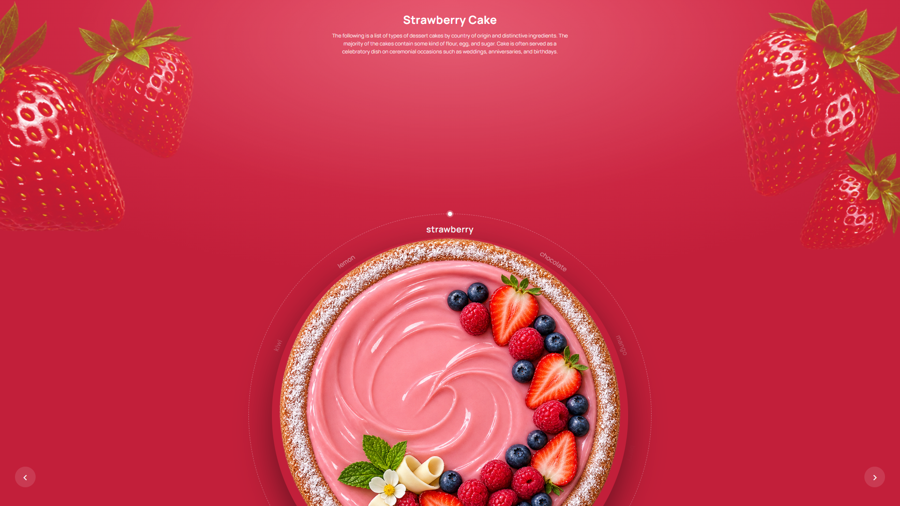

# Zawadi Cakes

A single scrolling landing page for **Zawadi Cakes**, a made-up handmade torte bakery in Nairobi. *Zawadi* is Swahili for "gift".

The hero has six flavours: Strawberry, Chocolate, Mango, Berry, Kiwi and Lemon. When you switch flavour, the colour scheme changes, the blob shapes behind the cake morph, the cake image is swapped and the flavour name animates in letter by letter. Scroll down and the selected cake flies out of the hero into the "Our story" section. The sections below the hero use only colours from the six flavour palettes.



## Tech stack

| Layer | Tool | What it does here |
| --- | --- | --- |
| UI | **React 19** (JSX, no TypeScript) | Every part of the page is a component. State is kept in `useState` (no Redux etc.) |
| Build | **Vite 7** + `@vitejs/plugin-react` | Dev server and production build. Vendor code is split into separate `react`, `motion` and `vendor` chunks |
| Animation | **GSAP 3.13**: `SplitText`, `ScrollTrigger` | Hero intro, letter-by-letter flavour name, scroll-scrubbed cake flight, pinned "curtain" reveal, card entrances |
| Smooth scroll | **Lenis 1.3** | Smooth wheel scrolling, driven by GSAP's ticker so ScrollTrigger stays in sync |
| Graphics | Inline **SVG** + **Canvas 2D** | Morphing blob silhouettes (SVG paths); the topping "sprinkle" particles on menu cards (canvas) |
| Styling | Plain **CSS** with custom properties | No Tailwind. Each flavour sets `--c1`, `--c2`, `--tint` and `--tint2`, which GSAP tweens |
| Fonts | **Poppins** + **Playfair Display**, self-hosted `woff2` | Latin subset; only the weights in use are included, and the hero font is preloaded |
| Images | **WebP**, with 640px copies used via `srcset` | Cake cut-outs, plus Unsplash-licensed photos for Occasions and Sizes |
| Lint | **ESLint 9** (flat config), react-hooks, react-refresh | `npm run lint` |
| Hosting | **Vercel** (`vercel.json`) / Netlify (`public/_redirects`) | SPA rewrite to `index.html`; long cache headers on `/assets`, `/fonts` and `/zawadi` |

`react-router-dom` is installed but no longer used: the site is one page at `/`, and any other path is replaced with `/`.

## Page structure

All page content (prices, menu, sizes, delivery zones, offer) is in [`src/zawadi/data.js`](src/zawadi/data.js).

| # | Section | Colour | Component |
| --- | --- | --- | --- |
| 1 | Hero with flavour switcher, autoplay, cart | active flavour | `ZawadiHero.jsx` |
| 2 | Our story: pinned curtain reveal, counting stats | mango | `About` |
| — | Cake flight from the hero into the story frame | — | `CakeFlight.jsx` |
| 3 | Menu: category tabs, cards with topping particles on hover | chocolate | `Menu`, `CakeSprinkle.jsx` |
| 4 | Occasions: story-style card marquee; clicking a card opens the matching Menu tab | strawberry | `Occasions`, `ui/stories-carousel.jsx` |
| 5 | Flavours & ingredients | active flavour's tint | `Flavours` |
| 6 | Sizes & servings | lemon | `Sizes` |
| 7 | Gallery: curved, tilted image reel | berry | `Gallery`, `ui/tilted-grid-hero.jsx` |
| 8 | Cake of the month offer band | strawberry | `Offer` |
| 9 | Delivery zones, pickup, hours, Google Maps embed | kiwi | `Delivery` |
| 10 | Footer: Instagram strip and newsletter | dark `#1b0f0b` + lemon | `Footer` |

```
src/
  main.jsx            mounts once fonts are ready (1s timeout)
  App.jsx             single page; other paths are replaced with "/"
  zawadi/
    ZawadiPage.jsx    page layout, cart (localStorage), toast
    ZawadiHero.jsx    hero, blob engine, flavour switching
    CakeFlight.jsx    scroll-scrubbed hero → story cake flight
    CakeSprinkle.jsx  canvas topping particles for menu cards
    ZawadiSections.jsx  every section below the hero
    data.js           all content and the six flavour palettes (TORTES)
    blob.js           blob path maths
    smoothScroll.js   Lenis + ScrollTrigger setup
    *.css             hero and section styles
  components/ui/      stories carousel and tilted grid (21st.dev components rewritten as plain JSX/CSS)
public/
  zawadi/             tarts, occasions and sizes images (WebP)
  fonts/              self-hosted woff2
```

## Run it

```bash
npm install
npm run dev       # http://localhost:5173
npm run build     # production build in dist/
npm run preview   # serve the build locally
npm run lint
```

## Accessibility and performance

- `prefers-reduced-motion` turns off smooth scrolling and shortens the intro animation.
- Only the first cake image loads up front. The other five load when the browser is idle, or straight away if you pick one.
- The blob wobble animation only runs while the hero is on screen.
- The cart count is saved in `localStorage`. If storage is unavailable, the cart still works for the current visit.

## Still placeholder

Replace these before going live: the monthly offer, the Instagram link and handle, delivery fees and zones, phone and email, and the About photo. The newsletter form has no backend.

## Image credits

Photos in the Occasions and Sizes sections are from [Unsplash](https://unsplash.com) under the Unsplash License (commercial use allowed, no attribution required). The cake cut-outs are the project's own assets.

## Recreate it

[`PROMPT.md`](PROMPT.md) contains a prompt you can give an AI coding assistant to build a page like this from scratch.
